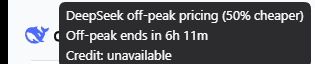

# DeepSeek peak whale

[](https://github.com/justjeet360/deepseek-peak-whale/actions/workflows/test.yml)
[](LICENSE)

DeepSeek peak/off-peak pricing as a small, framework-free library, plus a DeepSeek Harness plugin that recolors the existing sidebar whale.

- **Library:** compute peak windows, the next transition, countdown text, and wallet formatting with no network or DSH dependency.
- **Harness plugin:** blue whale while off-peak, red while peak, with a hover tooltip for the countdown and available credit.



*The tooltip shows the rate, countdown, and credit. The screenshot uses the credit-unavailable state.*

## Library

```js
import {
  currentRate,
  formatRemaining,
} from 'deepseek-peak-whale/pricing';

const now = new Date();
const rate = currentRate(now);
console.log(rate.peak ? 'Peak rate' : 'Off-peak rate');
console.log(`Changes in ${formatRemaining(rate.remainingMs)}`);
```

### API

| Export | Description |
|---|---|
| `isPeak(now?, options?)` | Whether DeepSeek is charging its peak rate. |
| `nextTransition(now?, options?)` | Next boundary as `{ at: Date, nextPeak: boolean }`. |
| `currentRate(now?, options?)` | `{ peak, at, remainingMs }` snapshot. |
| `formatRemaining(ms)` | Compact duration such as `2d 4h` or `18m 03s`. |
| `formatWallet(wallet, locale?)` | Platform-style `¥`/`$` amount. |
| `beijingParts(now?)` | Weekday, minute-of-day, and ISO date in Beijing. |
| `DEFAULT_CHINA_HOLIDAYS` | Included 2026–2027 holiday ranges. |
| `PEAK_WINDOWS`, `RATE_COLORS` | Schedule and default palette constants. |

Pass `{ holidays: [['2027-10-01', '2027-10-07']] }` to override the calendar.

Schedule: peak is Monday–Friday, 09:00–12:00 and 14:00–18:00 Beijing time (01:00–04:00 and 06:00–10:00 UTC), excluding Chinese public holidays. Weekends and holidays are off-peak all day.

The included holiday calendar covers 2026 and 2027. Update `DEFAULT_CHINA_HOLIDAYS` when the next State Council calendar is published; the API remains correct for later years, but it will not know new holidays until the data is updated.

## Harness plugin

### Install

Install the package directory as a local bundle through **Plugins** → **Add plugin**, or publish it to npm and install it from the plugin index.

No configuration is required.

### Behavior

- Blue `#4D6BFE` = off-peak, 50% cheaper.
- Red `#E5484D` = peak.
- The rate flag refreshes every 15 seconds.
- Hover or focus the whale for the rate, a one-second countdown to the next transition, and credit.
- Credit is cached for 60 seconds.
- The same mark is used in the expanded sidebar and the collapsed rail.

## Credit and privacy

The package contains no API keys, account IDs, tokens, personal paths, or telemetry.

When credit is available:

1. If a DeepSeek Platform account is signed in, the plugin reads its balance through the existing DSH account service.
2. Otherwise the Host reads `DEEPSEEK_API_KEY` from the DSH credential store (falling back to the launch environment) and calls DeepSeek's `/user/balance` endpoint. Only currency amounts cross the authenticated local Host route; the key never reaches the browser.
3. If neither source is available, the tooltip shows **Credit: unavailable**.

Never put a key in `cordis.yml`, a committed `.env` file, or this package. The `.gitignore` excludes environment files.

## Development

```sh
npm run build   # regenerate client.js from src/pricing.js + src/client-template.js
npm test        # pure schedule and adapter tests
npm pack --dry-run   # inspect the publishable file list
```

`client.js` is generated and committed so DSH can load it without a build step. Edit `src/`, then run `npm run build`.

The repository is [github.com/justjeet360/deepseek-peak-whale](https://github.com/justjeet360/deepseek-peak-whale).

## Support

If this saves you money, star the repository so other DeepSeek Harness users can find it.

## License

MIT. See [LICENSE](LICENSE).
